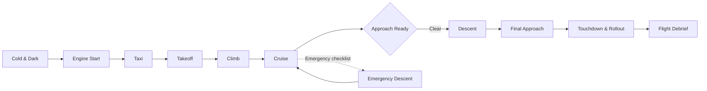

<p align="center">
  
</p>

<h1 align="center">NextAir</h1>

<p align="center">
  A real-time 2D aeronautical flight simulator with route planning, cold-and-dark operations, live traffic, emergency scenarios, and checkride scoring.
</p>

<p align="center">
  <a href="https://nextjs.org"></a>
  <a href="https://react.dev"></a>
  <a href="https://www.typescriptlang.org"></a>
  <a href="https://tailwindcss.com"></a>
  <a href="https://leafletjs.com"></a>
</p>

<p align="center">
  <a href="#quick-start"><strong>Quick Start</strong></a> ·
  <a href="#choose-your-mission"><strong>Choose a Mission</strong></a> ·
  <a href="#scenarios--checkrides"><strong>Scenarios</strong></a> ·
  <a href="#cockpit-controls"><strong>Controls</strong></a> ·
  <a href="#development"><strong>Development</strong></a>
</p>

---

## Contents

- [What is NextAir?](#what-is-nextair)
- [Quick Start](#quick-start)
- [Choose Your Mission](#choose-your-mission)
- [Flight Lifecycle](#flight-lifecycle)
- [Feature Highlights](#feature-highlights)
- [Fleet & Route Presets](#fleet--route-presets)
- [Scenarios & Checkrides](#scenarios--checkrides)
- [Planning & Navigation](#planning--navigation)
- [Cockpit Controls](#cockpit-controls)
- [Tech Stack](#tech-stack)
- [Project Map](#project-map)
- [Development](#development)
- [Environment](#environment)
- [Troubleshooting](#troubleshooting)
- [Contributing](#contributing)

---

## What is NextAir?

NextAir is a browser-based 2D flight simulator built around a real-time flight state machine. Start cold and dark, bring the aircraft to life, taxi to the runway, fly a planned route, manage fuel and systems, handle in-flight emergencies, and land with a full debrief.

The simulator runs entirely on the client. The only server route is the optional live-traffic proxy.

**Pick your path:**

| I want to... | Start here |
| --- | --- |
| Fly a route right now | [Quick Start](#quick-start) |
| Try an emergency or checkride | [Scenarios & Checkrides](#scenarios--checkrides) |
| Understand the simulation model | [Flight Lifecycle](#flight-lifecycle) |
| Work on the code | [Development](#development) |

---

## Quick Start

### Prerequisites

- Node.js **20.9+** recommended
- npm
- A modern browser with WebGL and AudioContext support

### Run locally

```powershell
npm install
npm run dev
```

Open [http://localhost:3000](http://localhost:3000) or the port shown in the terminal.

### Production

```powershell
npm run build
npm run start
```

### First flight in 60 seconds

1. Pick an origin, destination, and aircraft.
2. Review the fuel plan and launch the flight.
3. In **Ground Operations**, switch on Battery, Beacon, and Fuel Pumps.
4. Start both engines, release the parking brake, and set flaps.
5. Taxi to the runway and line up.
6. Use **Time Warp** to accelerate the climb and cruise.
7. Clear for landing at Top of Descent and complete the rollout.

> Tip: enable **Auto-Land** for long flights at high time-warp, or keep it manual to fly the approach yourself.

---

## Choose Your Mission

<details open>
<summary><strong>Dispatch and plan a flight</strong></summary>

- Select countries, airports, and an aircraft from the fleet.
- Compare range, cruise speed, ceiling, and fuel feasibility.
- Load a preset route or build a custom route.
- Import an ICAO flight plan, SimBrief route, or plain route string.
- Review trip fuel, contingency, alternate fuel, final reserve, and optional layover stops.

</details>

<details>
<summary><strong>Start cold and dark</strong></summary>

- Battery, beacon, fuel pumps, and parking brake are required before engine start.
- Engine spool-up takes time and is shown live in Ground Operations.
- Normal checklists validate automatically as systems are configured.
- Taxi, line-up, and takeoff become available only when the required checklist items are complete.

</details>

<details>
<summary><strong>Fly the route</strong></summary>

- Track the aircraft along the filed waypoint path.
- Monitor altitude, airspeed, Mach, heading, vertical speed, fuel, ETA, and progress.
- Use time warp from 1x to 500x.
- Handle Top of Descent and landing clearance manually or with Auto-Land.
- Land, roll out, and review the debrief.

</details>

<details>
<summary><strong>Handle an emergency</strong></summary>

- Open **Scenarios** from the cockpit ribbon while airborne.
- Choose Training or Checkride mode.
- Complete the interactive emergency checklist in order.
- Action steps change the aircraft state, such as alternate gear extension or emergency descent.
- End the drill to restore normal systems.

</details>

<details>
<summary><strong>Take a checkride</strong></summary>

- Checkrides score checklist completion, response time, aircraft configuration, and landing safety.
- Complete the emergency checklist to see an in-flight score.
- The final score is recalculated in the arrival debrief, including gear-down landing safety.
- Passing requires a score of 80 or higher and a completed checklist.

</details>

---

## Flight Lifecycle



The pure simulator lives in `lib/simulation.ts`. It advances altitude, speed, fuel, position, phase, engines, configuration, cabin altitude, and ETA from the current telemetry and flight plan.

---

## Feature Highlights

| Area | What is included |
| --- | --- |
| Flight planning | Country and airport selection, twelve-aircraft fleet, non-stop range validation, preset routes, custom routes, ICAO/SimBrief import |
| Fuel planning | Trip, contingency, alternate, final reserve, taxi fuel, tank and range checks, diversion airport, one-stop layover feasibility |
| Ground operations | Cold and dark, battery, beacon, fuel pumps, parking brake, engine start, taxi, takeoff |
| Flight model | Climb, cruise, descent, final approach, touchdown, rollout, time warp, fuel burn, engine-out performance |
| Map | Leaflet radar, great-circle routes, aircraft marker, altitude shadow, TOD marker, tile styles, auto-follow with city-level zoom, fit controls |
| Traffic | OpenSky proxy, local traffic fallback, TCAS advisories, route-aware conflict filtering |
| Avionics | PFD cards, primary flight data, progress bar, phase badge, warnings, audio ambience |
| Scenarios | Engine failure, gear jam, depressurization, emergency descent, interactive checklists |
| Checkrides | Timed response scoring, configuration checks, safe-landing evaluation, debrief results |
| Persistence | Active flight restore under `nextair.activeFlight.v1` |
| Platform | Responsive HUD, PWA manifest/service worker, day/night map treatment |

---

## Fleet & Route Presets

The dispatch fleet covers long-haul widebodies, narrowbody and regional jets, a supersonic airliner, a long-range business jet, and a general-aviation trainer. The default aircraft is the Boeing 787-9.

| Aircraft | ID | Type | Cruise | Max range | Pax | Engines | Role |
| --- | --- | --- | ---: | ---: | ---: | ---: | --- |
| Boeing 787-9 Dreamliner | `b787-9` | Widebody | 903 km/h | 14,140 km | 296 | 2 | Flagship long-haul |
| Airbus A350-900 XWB | `a350-900` | Widebody | 903 km/h | 15,370 km | 315 | 2 | Ultra-long-haul |
| Boeing 777-300ER | `b777-300er` | Widebody | 905 km/h | 13,650 km | 396 | 2 | High-capacity long-haul |
| Airbus A380-800 | `a380-800` | Widebody | 903 km/h | 14,800 km | 555 | 4 | Mega-hub flagship |
| Boeing 777-200LR | `b777-200lr` | Widebody | 905 km/h | 15,843 km | 317 | 2 | Non-stop city pairs |
| Boeing 737-800 NextGen | `b737-800` | Narrowbody | 838 km/h | 5,436 km | 175 | 2 | Short/medium-haul workhorse |
| Airbus A320neo | `a320neo` | Narrowbody | 828 km/h | 6,300 km | 180 | 2 | Efficient short/medium-haul |
| Airbus A321neo | `a321neo` | Narrowbody | 833 km/h | 7,400 km | 220 | 2 | Transatlantic narrowbody |
| Embraer E195-E2 | `e195-e2` | Narrowbody | 833 km/h | 4,800 km | 132 | 2 | Regional and thin routes |
| Aérospatiale / BAC Concorde | `concorde` | Supersonic | 2,158 km/h | 7,222 km | 100 | 4 | Mach 2.04 dash |
| Gulfstream G650ER | `g650er` | Business | 904 km/h | 13,890 km | 19 | 2 | Executive ultra-long-haul |
| Cessna 172 Skyhawk | `c172` | General | 226 km/h | 1,185 km | 4 | 1 | Training and scenic flights |

### Preset routes

Presets set the origin, destination, and aircraft. The nav route, airline callsign where available, fuel plan, and layover options are then built automatically.

| Preset | Route | Aircraft | Dispatch note |
| --- | --- | --- | --- |
| Transatlantic Dreamliner | JFK → LHR | 787-9 | Non-stop |
| Transpacific Crossing | SFO → HND | A350-900 | Non-stop |
| Supersonic Atlantic Dash | LHR → JFK | Concorde | Non-stop |
| European City Hopper | LHR → CDG | A320neo | Non-stop |
| Middle East Hub | DXB → SIN | 787-9 | Non-stop |
| Arabian Sea Crossing | DXB → KHI | A320neo | Non-stop |
| Heathrow to Islamabad | LHR → ISB | 787-9 | Non-stop |
| Kangaroo Mega Route | SYD → LHR | A380-800 | One technical stop required |
| Pacific Twinjet | SFO → SIN | 777-200LR | Non-stop |
| Neo Transatlantic | JFK → FRA | A321neo | Non-stop narrowbody |
| Regional Europe | LHR → FCO | E195-E2 | Non-stop |
| Executive Transpacific | LAX → SYD | G650ER | Non-stop business jet |

The Kangaroo Mega Route is intentionally beyond the A380's non-stop range. Select a highlighted layover airport, review both leg fuel plans, then file the one-stop flight.

---

## Scenarios & Checkrides

Open **Scenarios** in the cockpit ribbon while in climb, cruise, approach-ready, or descent.

<details>
<summary><strong>Engine Failure</strong></summary>

**Objective:** maintain control, identify the failed engine, secure it, and plan the driftdown.

1. Maintain aircraft control.
2. Identify the failed engine.
3. Secure the failed engine.
4. Assess driftdown and diversion.

The simulation reduces available performance and fuel flow while an engine is failed. Checkride scoring verifies the secure-engine action and timely response.

</details>

<details>
<summary><strong>Gear Jam</strong></summary>

**Objective:** attempt a normal extension, then use the alternate gear extension procedure.

1. Place the gear lever down and leave it down.
2. Check the gear circuit breakers.
3. Perform the alternate gear extension.
4. Configure for landing.

Normal gear controls are locked during the drill. The alternate extension sets the gear down and changes the cockpit warning to `GEAR ALT EXT`.

</details>

<details>
<summary><strong>Depressurization</strong></summary>

**Objective:** don oxygen, start an emergency descent, secure the cabin, and level off at 10,000 ft.

1. Oxygen masks on.
2. Start the emergency descent.
3. Secure the cabin.
4. Level off at 10,000 ft.

Cabin altitude rises until the descent begins. The aircraft enters `EMERGENCY_DESCENT`, descends at an increased rate, and levels off at 10,000 ft. The level-off checklist step stays locked until the aircraft is below 11,000 ft.

</details>

### Checkride scoring

| Factor | Effect |
| --- | --- |
| Checklist completed | Required to pass |
| First action within 60 seconds | 15-point penalty when late |
| Correct aircraft configuration | 20-point penalty when unmet |
| Safe landing with gear down | 30-point penalty in the final debrief |
| Passing score | 80 or higher |

Training mode runs the same checklist without scoring.

---

## Planning & Navigation

<details open>
<summary><strong>Custom routes and imported flight plans</strong></summary>

The route editor accepts:

- ICAO flight plans such as `(FPL-...-EGLL...-KJFK...)`
- SimBrief/OFP-style `ROUTE:` sections
- Plain route strings with DCT, airways, navaids, and coordinate fixes

Supported coordinate formats include `50N030W`, `N50W030`, and `5030N03000W`. Airway tokens such as `UL9`, `N888`, `NATD`, and `PACOTS` are preserved and displayed separately.

> Local navaid data does not contain all 4/5-letter fixes. Unresolved fixes are surfaced as warnings instead of being silently dropped.

</details>

<details>
<summary><strong>Fuel and layovers</strong></summary>

- Fuel plans use aircraft burn rates, route distance, alternate distance, contingency, final reserve, and taxi fuel.
- A direct dispatch must fit both the tanks and the aircraft's published maximum non-stop range.
- When either limit is exceeded, the planner searches for a single technical refuel stop, validates fuel and range on both legs, sorts candidates by detour, and shows up to eight options.
- Custom imported routes disable automatic layovers because the imported route is treated as intentional.
- The cockpit tracks fuel remaining, fuel used, flow rate, and reserve warnings.

</details>

<details>
<summary><strong>Live traffic and TCAS</strong></summary>

- Traffic is fetched through `app/api/traffic/route.ts` to avoid browser CORS restrictions.
- OpenSky anonymous access is rate-limited: use bounding boxes and avoid unnecessary polling.
- The simulator merges live traffic with local sectors and produces TCAS advisories.
- TCAS advisories are suppressed below 400 ft AGL.

</details>

---

## Cockpit Controls

| Control | Purpose |
| --- | --- |
| Play / Pause | Start or stop simulation time |
| Reset | Return to the origin gate |
| Time Warp | 1x, 5x, 10x, 25x, 50x, 100x, 250x, 500x |
| Auto-Land | Automatically clear the approach at Top of Descent |
| Battery / Beacon / Fuel Pumps | Required ground systems |
| Engine buttons | Start or cancel engine spool-up |
| Flaps / Gear / Speedbrake | Flight configuration |
| Scenarios | Open Instructor Station |
| Emergency checklist | Click the next checklist action in order |
| End Drill | Restore normal systems after a scenario |
| Clear for Landing | Approve descent and approach |
| Sound | Mute or unmute cockpit audio |
| Fullscreen | Enter or exit fullscreen |
| Follow Aircraft | Recenter and zoom to city-level detail |
| Fit Full Route | Frame the entire planned route |
| Flight Dispatch | Leave the active flight and return to planning |

---

## Tech Stack

| Layer | Technology |
| --- | --- |
| Framework | Next.js 16 App Router with Turbopack |
| UI | React 19, Tailwind CSS 4, lucide-react |
| Language | TypeScript strict mode |
| Map | Leaflet + OpenStreetMap/Mapbox/MapTiler/ESRI tiles |
| Simulation | Pure TypeScript state machine in `lib/simulation.ts` |
| Audio | Web Audio API ambience and one-shot effects |
| Persistence | localStorage |
| Traffic | OpenSky via server route |

---

## Project Map

<details>
<summary><strong>Open the repository structure</strong></summary>

```text
app/
  page.tsx                  Flight session, simulation loop, persistence, scenarios
  api/traffic/route.ts      Server-side traffic proxy
components/
  FlightPlanner.tsx         Dispatch, route editor, aircraft, fuel, launch
  CockpitHUD.tsx            Ground ops, controls, checklists, PFD, scenarios
  ScenarioPanel.tsx         Instructor launcher and interactive checklist
  FlightMap.tsx             Leaflet map and aircraft rendering
  FlightMapDynamic.tsx      Client-only map entry point
lib/
  simulation.ts             Pure flight-phase simulation
  ground.ts                 Engines, taxi, checklists, configuration drag
  routing.ts                Route construction, coordinates, airways
  flightPlanImport.ts       ICAO/SimBrief/plain-route parser
  aircraft.ts               Fleet specifications and range helpers
  airports.ts               Airport database used by dispatch and layovers
  fuel.ts                   Fuel plans, range, alternates, layovers
  scenarios.ts              Emergency definitions, checklist flow, scoring
  tcas.ts / traffic.ts      TCAS and live traffic logic
  audio.ts                  Web Audio cockpit ambience
types/
  flight.ts                 Flight, telemetry, aircraft, airport types
  scenario.ts               Scenario, checklist, evaluation types
```

</details>

---

## Development

### Scripts

| Command | Description |
| --- | --- |
| `npm run dev` | Start the development server |
| `npm run build` | Create a production build |
| `npm run start` | Serve the production build |
| `npm run lint` | Run ESLint |
| `npx tsc --noEmit` | Type-check without emitting files |
| `npm run pm2:start` | Start the production process with PM2 |
| `npm run pm2:logs` | View PM2 logs |

### Verification checklist

```powershell
npx tsc --noEmit
npm run lint
npm run build
```

There is no test runner configured. For UI changes, verify the affected flows in a production build using headless Chrome/Edge over the DevTools protocol.

The current lint baseline contains one pre-existing `simulationTick` declaration-order error in `app/page.tsx` and four warnings. Report any change to that baseline instead of treating it as a new regression.

### Contributor guide

See [AGENTS.md](AGENTS.md) for architecture, conventions, persistence rules, and domain notes.

---

## Environment

Copy `.env.example` to `.env.local` and fill only the values you need.

```powershell
Copy-Item .env.example .env.local
```

Common optional values:

| Variable | Purpose |
| --- | --- |
| `NEXT_PUBLIC_MAPBOX_TOKEN` | Mapbox tile styles |
| `NEXT_PUBLIC_MAPTILER_KEY` | MapTiler tiles |
| `NEXT_PUBLIC_DEFAULT_ORIGIN` | Default origin code |
| `NEXT_PUBLIC_DEFAULT_DESTINATION` | Default destination code |
| `NEXT_PUBLIC_DEFAULT_AIRCRAFT` | Default aircraft ID |
| `NEXT_PUBLIC_DEFAULT_TIME_WARP` | Default simulation speed |

Do not commit `.env.local` or expose private keys.

---

## Troubleshooting

<details>
<summary><strong>The map is blank or tiles are missing</strong></summary>

Check your network connection and optional Mapbox/MapTiler tokens. The simulator can still run with the default tile provider.

</details>

<details>
<summary><strong>Engines will not start</strong></summary>

Battery, fuel pumps, and parking brake must all be on before engine start. Check the Before Start checklist.

</details>

<details>
<summary><strong>Taxi or takeoff is disabled</strong></summary>

Complete the Before Start and After Start checklists for taxi. Before Takeoff also requires flaps and gear down.

</details>

<details>
<summary><strong>My imported route shows unresolved fixes</strong></summary>

The local navaid dataset is intentionally limited. Add the route with a nearby navaid or coordinate fix, or expect the unresolved-fix warning.

</details>

<details>
<summary><strong>My flight did not restore</strong></summary>

Flights are saved under `nextair.activeFlight.v1` when the tab is hidden or closed. Clearing site data or localStorage removes the saved session.

</details>

---

## Contributing

1. Read [AGENTS.md](AGENTS.md).
2. Keep simulation logic pure and deterministic.
3. Preserve persisted-flight compatibility.
4. Run typecheck, lint, and build before finishing.
5. Verify changed UI flows in a browser.

<p align="right"><a href="#nextair">Back to top</a></p>
